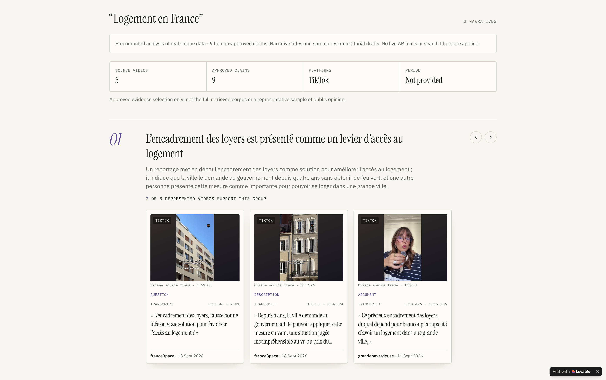

# Narrative DNA

**Trace a story back to its sources.**

An editorial atlas of housing narratives in France: explore what student-housing videos actually say, claim by claim, with every statement anchored to exact quotes, timestamps and original footage.

Built with Lovable during the OpenAI DevDay Community Hackathon in Paris, October 2026.

[](https://www.youtube.com/watch?v=WEa66XDc7dw)

**[Watch the demo](https://www.youtube.com/watch?v=WEa66XDc7dw)** · **[Try the public demo](https://narrative-evidence-atlas.lovable.app)** — no account, no API key, nothing to install.

## What you can do

- **Explore a precomputed analysis:** browse two narrative groups plus three standalone student-housing observations — nine human-approved claims extracted from five real Oriane videos.
- **Open the evidence behind every claim:** each card keeps the exact original quotation, bounded transcript context, source ID, fractional timestamp, creator handle, publication date and a verified frame from the source video.
- **Watch the originals:** evidence drawers mount the official TikTok player for verified sources — lazy-loaded, never autoplaying, with the quoted timestamp shown beside TikTok's own controls.
- **Develop safely:** opt-in mock data keeps local development free of provider keys and never ships in the production bundle.

## Tech stack

TanStack Start, React and TypeScript power the app, built as a Nitro Cloudflare worker. Production serves a validated, precomputed public payload through a single `NarrativeService` boundary, so a live backend can replace it without UI changes. The public payload is a whitelist projection of a human-approved analysis: no rejected candidates, reviewer identities or raw provider responses are included. Vitest covers frontend and core checks. **Lovable built and hosts the project; provider credentials never reach the browser.**

## Getting started

Use [Node.js 24.14.0](https://nodejs.org) and npm:

```sh
git clone <this-repository-url>
cd <repository-name>
npm i
npm run dev
```

Open the local URL and choose **View precomputed analysis** — the topic and platform are fixed, and no Oriane/OpenAI keys are required. For local development with fictional data instead:

```sh
VITE_NARRATIVE_MODE=mock npm run dev
```

## Verification

```sh
npm run typecheck
npm run lint
npm test
npm run build
```

The production build emits a Cloudflare worker (`.output/server/wrangler.json`) plus browser assets (`.output/public`); deploy through the connected Lovable workflow. Browser assets are checked to contain no provider key names, provider API hostnames or mock identifiers.

## Hackathon

Narrative DNA was built for the **OpenAI DevDay Community Hackathon — Paris, October 2026**. The public demo is a real, anonymously verified deployment: nine approved cards with restored creator and date metadata and seven unique public Oriane frames. It is an independent project, without a claim of OpenAI or Oriane endorsement or affiliation.

## Documentation

[Deployment and provenance](DEPLOYMENT.md) · [Latest iteration report](FINAL_ITERATION.md) · [Roadmap](roadmap.md) · [Presenter](presenter/README.md)

## Current limits

Explore runs on a precomputed analysis; live search is not connected. The topic and platform are fixed. Three of the nine frames sit outside the quoted interval and are explicitly labelled with their actual timestamp; one source's official player showed a network error in testing, though its link, image and citation remain intact. TikTok's canonical publication page may show a login prompt depending on browser or region. Narrative titles and summaries remain editorial drafts.
